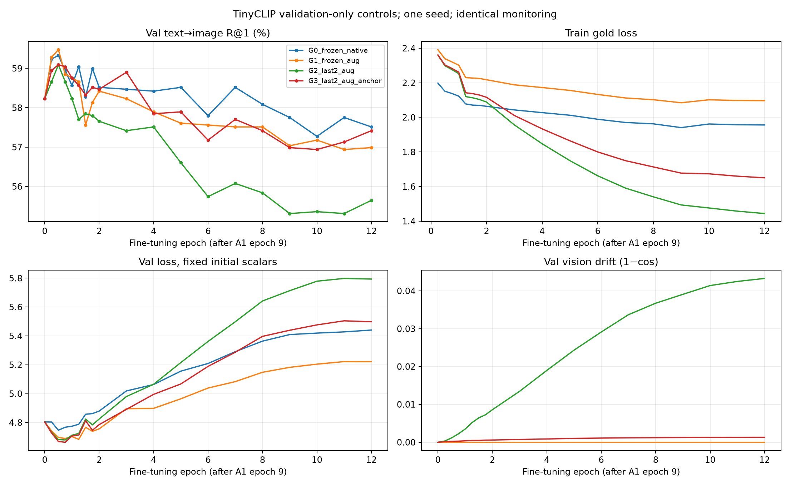

# TinyCLIP: augmentacja i ochrona geometrii

FULL_CLEAN i walidacja bez zmian. PolDense frozen. Seed 42; wspólny start A1 epoka 9. 
LR head 1e-4, vision 1e-5; warmup 1 epoka, cosine do 10%, pełne 12 epok.
Checkpoint po val t2i R@1; gęstszy pomiar w pierwszych dwóch epokach, identyczny we wszystkich kontrolach.
Augmentacja: zoom 1–1.08 i przesunięcie ±3%; bez flipów i zmian koloru.
Anchor: 50 × (1-cos) do oryginalnych cech TinyCLIP na tym samym widoku. Siła z gradientów TRAIN.

| Experiment | Feature source | Projector | Vision trainable blocks | Trainable params | Val t2i R@1 | Val i2t R@1 | Best epoch |
|---|---|---|---:|---:|---:|---:|---:|
| G0_frozen_native | projected TinyCLIP | Linear 512→384 | 0 | 196,994 | 59.33% | 69.93% | 0.502 |
| G1_frozen_aug | projected TinyCLIP | Linear 512→384 | 0 | 196,994 | 59.47% | 69.69% | 0.502 |
| G2_last2_aug | projected TinyCLIP | Linear 512→384 | 2 | 6,501,762 | 59.09% | 69.69% | 0.502 |
| G3_last2_aug_anchor | projected TinyCLIP | Linear 512→384 | 2 | 6,501,762 | 59.09% | 69.69% | 0.502 |

MSCOCO test i XM3600 nieuruchamiane. To scout jednego seeda; małe różnice nie są dowodem poprawy.

Checkpointy ponownie odtworzono z dysku: R@1/5/10 obu kierunków i val loss zgodne.

| Porównanie | Δ t2i R@1 (p.p.) | 95% paired interval (p.p.) |
|---|---:|---|
| G1_frozen_aug_minus_G0_frozen_native | +0.144 | [-0.384, +0.714] |
| G2_last2_aug_minus_G1_frozen_aug | -0.383 | [-1.054, +0.287] |
| G3_last2_aug_anchor_minus_G1_frozen_aug | -0.383 | [-1.006, +0.240] |
| G3_last2_aug_anchor_minus_G2_last2_aug | +0.000 | [-0.480, +0.478] |

Bootstrap po komponentach obrazów/parentów i wspólnych captionów; bez korekty selekcji konfiguracji i wariancji seedów.

