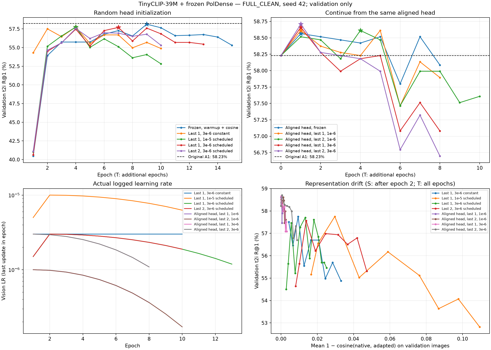

# TinyCLIP: learning rate, warmup and aligned-head finetuning

FULL_CLEAN and validation unchanged. Seed 42. No test or XM3600 evaluation.
Native projected TinyCLIP-39M features, linear projector, frozen PolDense, unchanged multi-positive sigmoid.

| experiment | init | blocks | projector LR | vision LR | warmup epochs | cosine | trainable params | val t2i R@1 | val i2t R@1 | best epoch |
|---|---|---:|---:|---:|---:|---|---:|---:|---:|---:|
| A1 | scratch | 0 | 0.001 | 0 | 0 | False | 196,994 | 58.23% | 69.69% | 9 |
| C1 | scratch | 1 | 0.001 | 1e-05 | 0 | False | 3,349,378 | 57.56% | 68.74% | 4 |
| C2 | scratch | 2 | 0.001 | 1e-05 | 0 | False | 6,501,762 | 56.46% | 65.63% | 2 |
| S0_frozen_schedule | scratch | 0 | 0.001 | 0 | 2 | True | 196,994 | 58.13% | 69.69% | 9 |
| S1_last1_low_constant | scratch | 1 | 0.001 | 3e-06 | 0 | False | 3,349,378 | 57.75% | 67.30% | 4 |
| S2_last1_schedule | scratch | 1 | 0.001 | 1e-05 | 2 | True | 3,349,378 | 57.75% | 67.54% | 4 |
| S3_last1_low_schedule | scratch | 1 | 0.001 | 3e-06 | 2 | True | 3,349,378 | 57.70% | 68.97% | 7 |
| S4_last2_low_schedule | scratch | 2 | 0.001 | 3e-06 | 2 | True | 6,501,762 | 57.56% | 66.59% | 4 |
| T0_frozen_aligned | A1_epoch9 | 0 | 0.0001 | 0 | 1 | True | 196,994 | 58.56% | 69.69% | 1 |
| T1_last1_aligned | A1_epoch9 | 1 | 0.0001 | 1e-06 | 1 | True | 3,349,378 | 58.61% | 70.41% | 1 |
| T2_last2_aligned | A1_epoch9 | 2 | 0.0001 | 1e-06 | 1 | True | 6,501,762 | 58.61% | 70.64% | 4 |
| T3_last1_aligned_mid | A1_epoch9 | 1 | 0.0001 | 3e-06 | 1 | True | 3,349,378 | 58.66% | 70.41% | 1 |
| T4_last2_aligned_mid | A1_epoch9 | 2 | 0.0001 | 3e-06 | 1 | True | 6,501,762 | 58.71% | 69.93% | 1 |

S: train from scratch, 20 epoch ceiling. T: same A1 epoch-9 projector/loss, fresh optimizer, 12 additional epochs.
T0 matches continuation of the head without vision updates. T1/T2 start from the identical head and loss scalars.
Warmup is linear per update; cosine decays to 10% of peak LR. Loss-scale/bias LR follows projector LR.
Early stopping: patience 6, at least 10 epochs for S / 8 for T. Epoch 0 is eligible to preserve the starting checkpoint.
Diagnostics include each group LR, gradient norms, sampled actual AdamW relative update size, parameter drift and feature drift.
Peak VRAM is peak PyTorch allocated memory. Each experiment uses one seed.

Rationale for aligned-head adaptation: https://arxiv.org/abs/2202.10054
Scheduler semantics: https://docs.pytorch.org/docs/stable/optim.html

## Interpretation of the matched comparisons

- S: best adapted **S2_last1_schedule**, val t2i R@1 **57.75%**, versus matched frozen **58.13%** (-0.38 pp).
- T: best adapted **T4_last2_aligned_mid**, val t2i R@1 **58.71%**, versus matched frozen **58.56%** (+0.14 pp).

Validation winner: **T4_last2_aligned_mid**, epoch 1.
One seed; these results describe the tested recipes and do not establish that all other finetuning recipes fail.
Warmup and cosine are tested together. Scheduled runs may stop before the planned cosine endpoint under the declared early-stopping rule.
No test score participates in the comparisons or winner selection.

Post-selection paired validation diagnostic vs matched control: +0.14 pp, conditional bootstrap interval [-0.43, +0.72] pp.
Bootstrap groups captions by shared positive-image components, keeping the gallery fixed. It does not account for model selection or between-seed variation.

