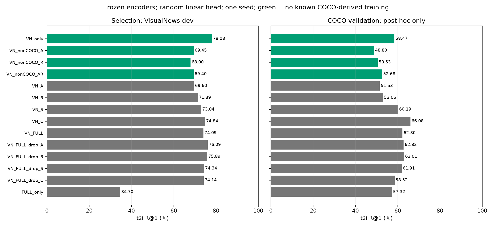
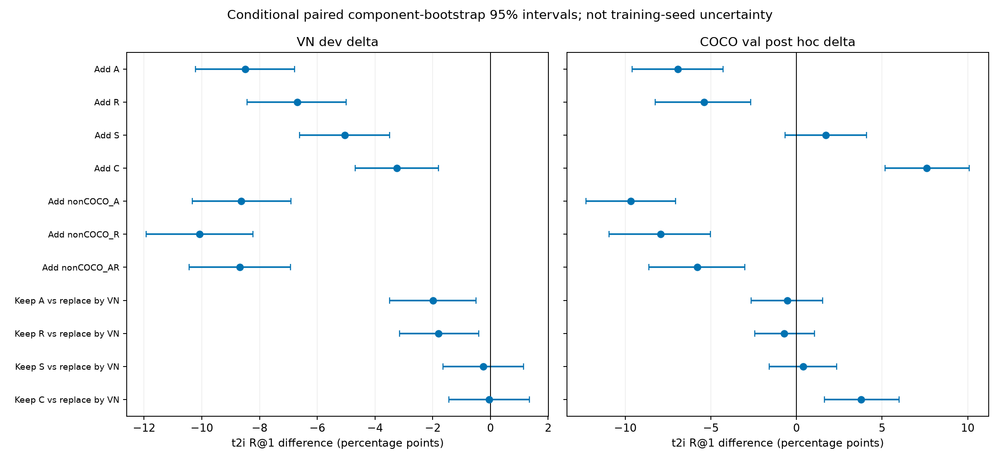

# Ablacja źródeł i COCO bez danych COCO w naszym treningu

TinyCLIP-39M i PolDense frozen. Projector Linear 512→384 od losowych wag, świeży sigmoid loss; 196 994 trenowalne parametry. Seed 42.
Każdy wariant: 5500 kroków i 1 405 780 prezentacji. LR 0.001, AdamW, native features bez augmentacji.
**Checkpointy i finaliści wybrani wyłącznie po VN dev, przed oceną COCO.** Brak wiki i retrieval XM3600.

A = ARO Attribution, R = ARO Relation, S = SugarCrepe, C = M-BEIR MSCOCO.

| Wariant | Bez znanego COCO train | Train pary | Train obrazy | VN dev t2i R@1 | COCO val t2i R@1 — post hoc | COCO val i2t R@1 — post hoc | Best krok |
|---|---|---:|---:|---:|---:|---:|---:|
| VN_only | tak | 33,906 | 33,851 | 78.08% | 58.47% | 68.02% | 1650 |
| VN_nonCOCO_A | tak | 47,201 | 35,953 | 69.45% | 48.80% | 64.20% | 1925 |
| VN_nonCOCO_R | tak | 45,084 | 36,279 | 68.00% | 50.53% | 64.44% | 3025 |
| VN_nonCOCO_AR | tak | 58,379 | 36,888 | 69.40% | 52.68% | 64.44% | 825 |
| VN_A | nie | 59,340 | 37,817 | 69.60% | 51.53% | 60.86% | 825 |
| VN_R | nie | 54,789 | 38,509 | 71.39% | 53.06% | 65.63% | 2475 |
| VN_S | nie | 40,009 | 35,161 | 73.04% | 60.19% | 72.55% | 2475 |
| VN_C | nie | 51,775 | 37,430 | 74.84% | 66.08% | 74.70% | 2200 |
| VN_FULL | nie | 104,195 | 44,496 | 74.09% | 62.30% | 71.84% | 2475 |
| VN_FULL_drop_A | nie | 78,761 | 43,358 | 76.09% | 62.82% | 71.84% | 1100 |
| VN_FULL_drop_R | nie | 83,312 | 42,670 | 75.89% | 63.01% | 73.27% | 2475 |
| VN_FULL_drop_S | nie | 98,092 | 43,215 | 74.34% | 61.91% | 70.41% | 1375 |
| VN_FULL_drop_C | nie | 86,326 | 40,953 | 74.14% | 58.52% | 67.30% | 1100 |
| FULL_only | nie | 70,289 | 10,645 | 34.70% | 57.32% | 66.59% | 1100 |

## Wybrani finaliści: benchmark COCO

Existing local MMEB MSCOCO_t2i and separately fixed whole gallery; not official COCO 5k
Local: 1000 zapytań; liczby kandydatów: {1000: 1000}. Osobna pełna galeria: 1002 obrazów / 1000 tekstów.

| Finalista | Bez znanego COCO train | Local R@1 | Local R@5 | Local R@10 | Fixed gallery t2i R@1 |
|---|---|---:|---:|---:|---:|
| VN_only | tak | 45.00% | 75.00% | 84.20% | 45.00% |
| VN_nonCOCO_AR | tak | 42.40% | 70.80% | 81.40% | 42.30% |
| VN_FULL | nie — kontrola | 52.30% | 80.40% | 89.00% | 52.00% |

## Wpływ źródeł

Add: 50% VN / 50% dodane źródło kontra samo VN. Keep: pełna mieszanka kontra zastąpienie slotów danego źródła przez VN; pozostałe oryginalne sloty identyczne.
Przedziały są warunkowe: bootstrap grup zapytań (obrazy/artykuły/powiązania), bez niepewności seeda i selekcji checkpointu.

| Porównanie | VN dev Δ p.p. [95% CI] | COCO val post hoc Δ p.p. [95% CI] |
|---|---:|---:|
| VN_A_minus_VN_only | -8.49 [-10.22, -6.79] | -6.94 [-9.59, -4.30] |
| VN_R_minus_VN_only | -6.69 [-8.44, -5.00] | -5.41 [-8.25, -2.68] |
| VN_S_minus_VN_only | -5.04 [-6.61, -3.50] | +1.72 [-0.67, +4.10] |
| VN_C_minus_VN_only | -3.25 [-4.69, -1.80] | +7.61 [+5.17, +10.10] |
| VN_nonCOCO_A_minus_VN_only | -8.64 [-10.33, -6.91] | -9.67 [-12.29, -7.06] |
| VN_nonCOCO_R_minus_VN_only | -10.08 [-11.93, -8.23] | -7.94 [-10.94, -5.03] |
| VN_nonCOCO_AR_minus_VN_only | -8.69 [-10.44, -6.93] | -5.79 [-8.61, -3.02] |
| VN_FULL_minus_VN_FULL_drop_A | -2.00 [-3.49, -0.50] | -0.53 [-2.63, +1.54] |
| VN_FULL_minus_VN_FULL_drop_R | -1.80 [-3.16, -0.40] | -0.72 [-2.45, +1.05] |
| VN_FULL_minus_VN_FULL_drop_S | -0.25 [-1.64, +1.15] | +0.38 [-1.58, +2.35] |
| VN_FULL_minus_VN_FULL_drop_C | -0.05 [-1.45, +1.34] | +3.78 [+1.64, +6.00] |
| VN_FULL_minus_VN_only | -3.99 [-5.54, -2.44] | +3.83 [+1.28, +6.41] |
| FULL_only_minus_VN_only | -43.38 [-45.64, -41.03] | -1.15 [-4.02, +1.62] |

## Ograniczenia i pochodzenie

- Bez COCO dotyczy danych i wag projectora w naszym treningu. Oficjalna metadana VG, znane Flickr/COCO lineage oraz aliasy pliku/pikseli zostały sprawdzone. Nie jest to dowód braku nieznanych kopii ani braku COCO w pretreningu gotowych encoderów.
- Wszystkie 24 473 wiersze / 3037 obrazów strict ARO mają jawny wpis VG bez COCO ID; recheck transytywnych powiązań nie zmniejszył tej puli.
- VN dev to ten sam pipeline i dwa źródła newsowe co VN train, z modelowymi captionami. Wybór po VN dev może preferować VN kosztem COCO. Dane COCO nie służyły jednak żadnemu wyborowi w tej serii.
- Efekt źródła obejmuje również zmianę liczby różnych obrazów, stylu i liczby captionów oraz negatywów w batchu. Spadek nie dowodzi, że źródło szkodzi przy każdej proporcji lub przy większym budżecie.
- Jeden seed wystarcza do wstępnego screeningu dużych różnic; małe efekty wymagają powtórzeń. Przedziały nie korygują wielu porównań ani selekcji.
- Wyniki tej serii nie są bezpośrednią ablają wcześniejszego warm-startu A1: zmieniono selekcję na VN dev, losowy start, LR i augmentację. Wszystkie warunki wewnątrz tej serii są wspólne.
- Użyty benchmark COCO to dotychczasowy lokalny benchmark MMEB, oglądany w poprzednich badaniach. XM3600 pozostaje blind; wiki nie było ładowane.
