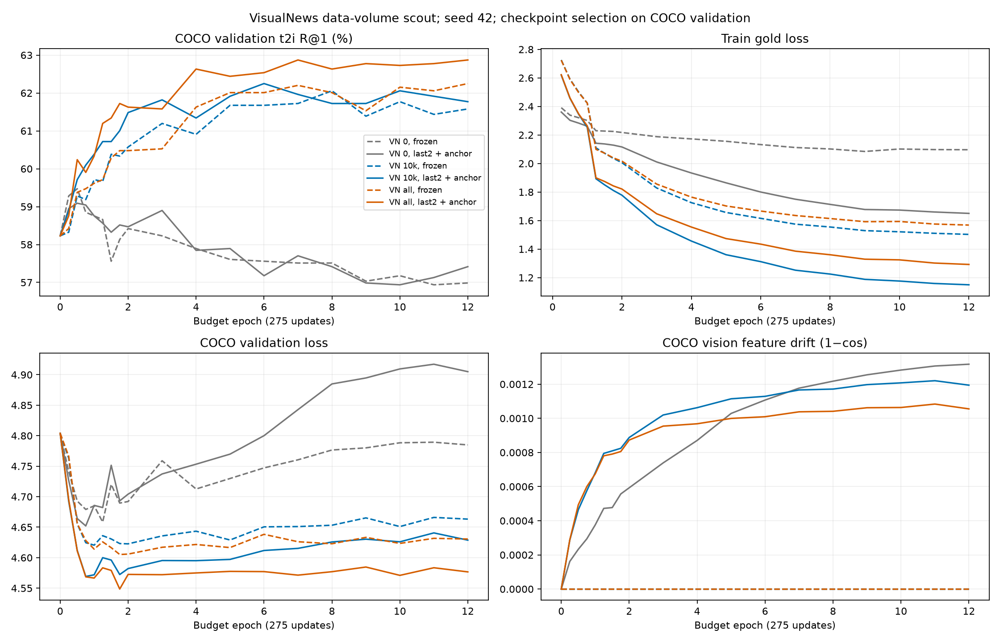
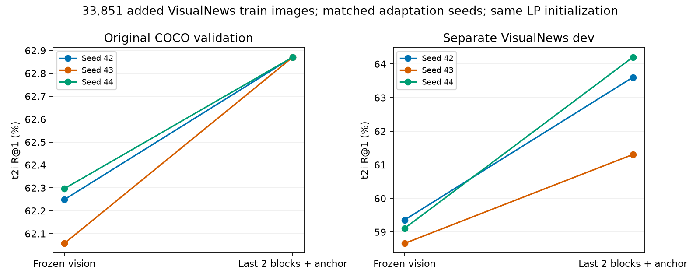

# TinyCLIP: liczba obrazów VisualNews a partial finetuning

FULL_CLEAN i dotychczasowa walidacja niezmienione. Osobny, zamrożony dodatek VN oraz VN dev.
Projector Linear 512→384, PolDense frozen, oryginalne projected TinyCLIP-39M. Warm start A1 ep. 9.
3300 aktualizacji, batch 256 (145 co 275 kroków), head LR 1e-4, vision LR 1e-5, warmup 275, cosine do 10%.
TRAIN z VN: 50% oryginalne wiersze FULL_CLEAN / 50% uniform VN images. Ta sama proporcja dla 10k i all.
Kontrole 0 VN odtworzone z G1/G3, bez powtarzania identycznego treningu. Ich ekspozycja na FULL_CLEAN jest dwukrotnie większa.
FT: ostatnie 2 bloki + anchor 50×(1−cos), augmentacja identyczna dla frozen i FT. Scout: seed 42; pełny dodatek powtórzony na seedach 43 i 44.
Checkpoint wyłącznie po dotychczasowym COCO val retrieval. VN dev oceniany dopiero w wybranym checkpointcie.

| Experiment | VN train images | Feature | Projector | Vision blocks | Trainable params | COCO val t2i R@1 | COCO val i2t R@1 | VN dev t2i R@1 | Best budget epoch |
|---|---:|---|---|---:|---:|---:|---:|---:|---:|
| VN_0_frozen | 0 | projected | Linear | 0 | 196,994 | 59.47% | 69.69% | 33.15% | 0.502 |
| VN_0_last2_anchor | 0 | projected | Linear | 2 | 6,501,762 | 59.09% | 69.69% | 32.70% | 0.502 |
| VN_10k_frozen | 10,000 | projected | Linear | 0 | 196,994 | 62.06% | 70.88% | 56.76% | 8.000 |
| VN_10k_last2_anchor | 10,000 | projected | Linear | 2 | 6,501,762 | 62.25% | 71.60% | 60.56% | 6.000 |
| VN_all_frozen | 33,851 | projected | Linear | 0 | 196,994 | 62.25% | 71.60% | 59.36% | 12.000 |
| VN_all_last2_anchor | 33,851 | projected | Linear | 2 | 6,501,762 | 62.87% | 71.84% | 63.60% | 7.000 |
| VN_all_frozen_seed43 | 33,851 | projected | Linear | 0 | 196,994 | 62.06% | 71.36% | 58.66% | 10.000 |
| VN_all_last2_anchor_seed43 | 33,851 | projected | Linear | 2 | 6,501,762 | 62.87% | 72.08% | 61.31% | 5.000 |
| VN_all_frozen_seed44 | 33,851 | projected | Linear | 0 | 196,994 | 62.30% | 71.36% | 59.11% | 11.000 |
| VN_all_last2_anchor_seed44 | 33,851 | projected | Linear | 2 | 6,501,762 | 62.87% | 72.08% | 64.20% | 8.000 |

Jedna epoka budżetu = 275 kroków; liczba kroków i prezentacji jest wspólna, nie liczba obiegów każdego zbioru.
VN dev ma osobną galerię i rozkład captionów; jego procentów nie porównywać bezpośrednio z COCO.
Scout i trzy seedy adaptacji dla pełnego dodatku. Test MSCOCO i XM3600 nieuruchamiane. SHA snapshotów sprawdzane przed i po.

Wyniki z wybranych checkpointów odtworzono po ponownym wczytaniu z dysku.

| Porównanie | COCO Δ R@1 p.p. [95% CI] | VN dev Δ R@1 p.p. [95% CI] |
|---|---|---|
| VN_0_last2_anchor_minus_VN_0_frozen | -0.38 [-1.01, +0.24] | -0.45 [-0.95, +0.05] |
| VN_10k_last2_anchor_minus_VN_10k_frozen | +0.19 [-0.77, +1.15] | +3.79 [+2.71, +4.88] |
| VN_all_last2_anchor_minus_VN_all_frozen | +0.62 [-0.34, +1.59] | +4.24 [+3.09, +5.41] |
| VN_10k_frozen_minus_VN_0_frozen | +2.58 [+0.95, +4.19] | +23.61 [+21.60, +25.62] |
| VN_all_frozen_minus_VN_10k_frozen | +0.19 [-0.72, +1.15] | +2.60 [+1.55, +3.60] |
| VN_all_last2_anchor_minus_VN_0_last2_anchor | +3.78 [+2.10, +5.48] | +30.90 [+28.75, +33.02] |
| VN_all_last2_anchor_seed43_minus_VN_all_frozen_seed43 | +0.81 [-0.14, +1.82] | +2.65 [+1.55, +3.75] |
| VN_all_last2_anchor_seed44_minus_VN_all_frozen_seed44 | +0.57 [-0.43, +1.54] | +5.09 [+3.94, +6.25] |

Bootstrap po komponentach; bez korekty selekcji i zmienności seedów.

## Pełny dodatek VN: trzy seedy adaptacji

Seedy 42/43/44 mają wspólny checkpoint startowy A1 ep. 9. Zmieniono wyłącznie seed adaptacji. Wartości poniżej to średnia ± odchylenie standardowe między seedami, w procentach.

| Vision | COCO val t2i R@1 | COCO val i2t R@1 | VN dev t2i R@1 |
|---|---:|---:|---:|
| frozen | 62.20 ± 0.13 | 71.44 ± 0.14 | 59.04 ± 0.35 |
| last2_anchor | 62.87 ± 0.00 | 72.00 ± 0.14 | 63.04 ± 1.53 |

| Last2 − frozen, t2i R@1 | Średnia ± SD różnicy (p.p.) | Warunkowy przedział 95% (p.p.) |
|---|---:|---:|
| coco | +0.67 ± 0.13 | [-0.16, +1.50] |
| vn | +3.99 ± 1.24 | [+3.03, +4.96] |

Przedział resampluje komponenty zapytań po uśrednieniu trzech dopasowanych seedów. Nie obejmuje niepewności seedów, wcześniejszego pretreningu projectora ani selekcji konfiguracji/checkpointów. Trzy seedy nie są wystarczające do mocnego wniosku o istotności populacyjnej.

## Interpretacja i ograniczenia

Na pełnym dodatku VN adaptacja dwóch bloków daje średnio +0.67 p.p. COCO val t2i R@1 wobec dopasowanego frozen (SD różnic 0.13 p.p.). Na osobnym VN dev średnia różnica wynosi +3.99 p.p. To wynik konkretnej recepty: dwa bloki + anchor, warm start, warmup i augmentacja. Nie rozstrzyga osobno wpływu każdego z tych składników.

Porównanie 0 VN z dodatkiem zmienia jednocześnie domenę danych, liczbę unikalnych obrazów i proporcję ekspozycji na FULL_CLEAN. Porównanie 10k/all trzyma proporcję źródeł i koszt treningu, ale obejmuje tylko jeden seed. Nie można przypisać całego zysku samej liczbie obrazów.

COCO val ma 419 obrazów i było używane we wcześniejszych eksperymentach. Warunkowe przedziały nie korygują wielokrotnego wyboru recepty i checkpointów. VN dev ma te same dwa źródła i pipeline generujący captiony co VN train; nie jest niezależnym testem ludzkich zapytań. Grupowanie artykułów i pHash ogranicza przeciek, ale nie gwarantuje rozdzielenia wszystkich wydarzeń ani wszystkich cropów.

Peak VRAM w nowych przebiegach obejmuje pełny cache RGB umieszczony na GPU. Nie należy porównywać go bezpośrednio z pamięcią historycznych kontroli 0 VN. Liczby parametrów i pełne logi lossów/gradientów są zapisane w JSON; tabela CSV zawiera metryki i checkpoint SHA.

Kolejny logiczny test metodologiczny to dopasowany LP→FT z projectorem najpierw wytrenowanym na całej mieszance FULL_CLEAN+VN, z kontrolą frozen o identycznym dodatkowym budżecie. W tej serii wszystkie adaptacje startują ze starego A1, wytrenowanego przed dodaniem VN. Ten wariant nie został tutaj uruchomiony. Przed końcową oceną MSCOCO należy zamrozić receptę i regułę wyboru seeda; XM3600 pozostaje blind i wymaga osobnej decyzji.
