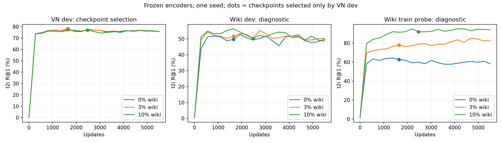

# Pilotaż wiki + VisualNews

Frozen TinyCLIP-39M (oryginalny embedding 512D) i PolDense-32M; losowy Linear 512→384, świeże skale sigmoid. 196 994 trenowalne parametry; seed 42.
Trzy treningi od wspólnych wag losowych: po 5500 kroków i 1 405 780 prezentacji, LR 0.001, AdamW, bez augmentacji. Wiki zastępuje 0%, 3% albo 10% slotów VN.
**Checkpoint wybierany wyłącznie po VN dev.** Wiki dev, wiki train probe i wynik w stałym kroku 5500 służą diagnozie. Nie oceniano COCO ani XM3600.

Zamrożony eksport: 1322 par, 2026-10-21T19:24:43.918951+00:00; poprawnie pobrane 1322, niepobrane 0.
Po kontroli: train 975 par / 975 obrazów / 115 komponentów; dev 201 par / 201 obrazów / 40 komponentów.
Podział łączy rzeczywiste encje Wikidata, źródłowy SHA1, piksele, podpisy i pHash≤6. Komponent z rozpoznanym powiązaniem z chronionymi danymi jest wykluczany w całości. Oryginalny FULL_CLEAN i split VN pozostają bez zmian.
Część obrazów pobrano jako oryginały z kontrolą SHA1, pozostałe jako oficjalne rendery Wikimedia 1280 px po potwierdzeniu SHA1 oryginału przez API. Tożsamość pobranych bajtów i przetwarzanie do wejścia CLIP są zapisane w audycie.

| Wariant | VN dev t2i R@1 / R@5 / R@10 | VN i2t R@1 | Wiki dev t2i R@1 / R@5 / R@10 | Wiki i2t R@1 | Wiki train probe R@1 | Best krok |
|---|---:|---:|---:|---:|---:|---:|
| WIKI_00pct | 78.08 / 92.16 / 95.41 | 74.45 | 49.75 / 80.40 / 87.94 | 41.79 | 62.81 | 1650 |
| WIKI_03pct | 77.38 / 92.36 / 95.41 | 73.90 | 51.76 / 81.91 / 89.45 | 45.77 | 77.89 | 1650 |
| WIKI_10pct | 77.03 / 92.31 / 95.56 | 74.25 | 50.25 / 83.92 / 89.95 | 48.26 | 91.96 | 2475 |

## Różnice względem VN bez wiki

Warunkowe 95% przedziały z parowanego bootstrapu komponentów zapytań; nie obejmują zmienności seeda ani wyboru checkpointu. Liczby w punktach procentowych.

| Wariant − 0% | VN dev Δ [95% CI] | Wiki dev Δ [95% CI] |
|---|---:|---:|
| WIKI_03pct | -0.70 [-1.34, -0.05] | +2.01 [-2.49, +6.31] |
| WIKI_10pct | -1.05 [-2.40, +0.30] | +0.50 [-6.60, +9.09] |

## Stały pełny budżet — diagnoza

| Wariant | VN dev R@1, krok 5500 | Wiki dev R@1, krok 5500 | Wiki train probe R@1, krok 5500 |
|---|---:|---:|---:|
| WIKI_00pct | 75.89 | 49.75 | 58.29 |
| WIKI_03pct | 75.84 | 50.25 | 82.41 |
| WIKI_10pct | 75.59 | 48.74 | 93.97 |

## Kierunek i2t — diagnoza

| Wariant − 0% | VN dev i2t Δ [95% CI] | Wiki dev i2t Δ [95% CI] |
|---|---:|---:|
| WIKI_03pct | -0.55 [-1.10, -0.05] | +3.98 [+0.39, +7.69] |
| WIKI_10pct | -0.20 [-1.25, +0.85] | +6.47 [+2.84, +10.19] |

Długość wejścia tekstowego: stały limit 128 tokenów. Przekracza go 74 z 1138 unikalnych podpisów wiki; mediana 70, maksimum 302. W tej serii pozostawiono wspólny limit bez zmian.

Wariant wskazany przez zapisaną przed treningami regułę pilotażu: **WIKI_00pct** (najniższy udział wiki z dodatnią różnicą wiki i spadkiem VN nie większym niż 0.5 p.p.).
Wynik opisuje reakcję na tę niewielką pulę wiki; nie przesądza o wartości większego korpusu. Wiki dev jest małe, podpisy przeszły automatyczną ocenę, a model może zapamiętywać treści powtarzane przez oversampling. Nie porównujemy surowych wyników wiki i VN między sobą: mają inne galerie i trudność.
Rozdzielność encji dotyczy wiki train względem wiki dev; VN nie ma kompletnego mapowania osób i obiektów do Wikidata, więc wspólne encje między VN a wiki nie są wykluczone.
Wiki dev zostało teraz obejrzane diagnostycznie; kolejne iteracje wymagają uwzględnienia tego w interpretacji. Brak znanych powiązań COCO dotyczy naszego treningu, bez gwarancji dla pretreningu gotowych encoderów lub nierozpoznanych kopii.

Kontrola: passed; odtworzono metryki i loss wszystkich wybranych i końcowych checkpointów, budżety oraz wcześniejszy wariant VN-only.

## Późniejsza ocena transferu

[Ocena transferu na COCO](tinyclip_wiki_coco_transfer.md). Rekomendacja powyżej powstała przed tą oceną i dotyczyła VN/wiki; nie stanowiła rozstrzygnięcia o użyteczności wiki na innych domenach.
